<p align="center">
  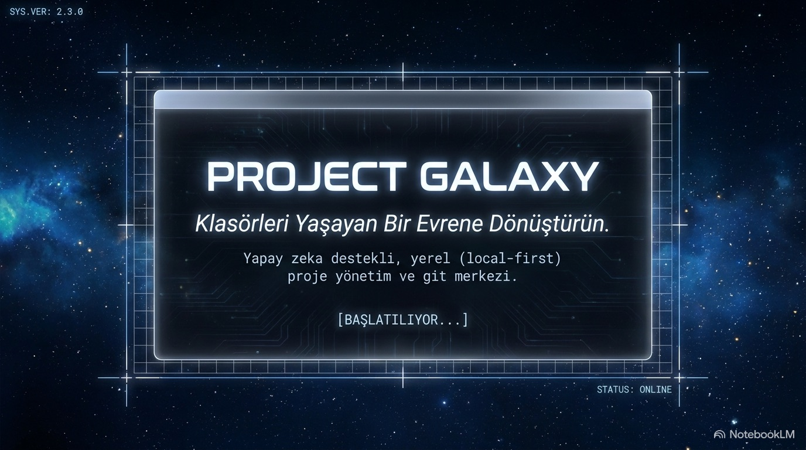
</p>

<h1 align="center">Project Galaxy</h1>
<p align="center"><b>Bilgisayarındaki projeleri bir evren olarak gez, yapay zekâ ajanlarınla yönet, tek pencereden geliştir.</b><br>
macOS · Windows · Electron · Claude Code · v2.3.13</p>

---

## İçindekiler

- [Bu uygulama ne işe yarar?](#bu-uygulama-ne-i̇şe-yarar)
- [Kurulum](#kurulum)
- [Terminoloji — galaksi · yıldız sistemi · gezegen](#terminoloji--galaksi--yıldız-sistemi--gezegen)
- [Arayüz turu](#arayüz-turu)
  - [Üst bar & navigasyon](#üst-bar--navigasyon)
  - [İstasyon Araçları (saat · hızlı ara)](#i̇stasyon-araçları)
  - [Uzay modu — galaksi haritası](#uzay-modu--galaksi-haritası)
  - [Gezegen modu — projenin içi](#gezegen-modu--projenin-i̇çi)
  - [Konsol — kalıcı bash + Claude oturumları](#konsol--kalıcı-bash--claude-oturumları)
  - [🔮 Galaxy Asistanı — dijital ikizin](#-galaxy-asistanı--dijital-ikizin)
  - [GİT — tek kapı](#gi̇t--tek-kapı)
- [Sekmeler](#sekmeler)
  - [PANO (Kanban)](#-pano--kanban)
  - [DB (Veritabanı gezgini)](#-db--veritabanı-gezgini)
  - [DOCKER](#-docker)
  - [ZAMANLAYICI](#-zamanlayıcı)
  - [SUNUCULAR (Uzak / SSH)](#-sunucular--uzak--ssh)
- [Yapay zekâ ajanların](#yapay-zekâ-ajanların)
- [Ayarlar](#ayarlar)
- [Kısayollar](#kısayollar)
- [Verilerim güvende mi?](#verilerim-güvende-mi)
- [Sık sorulanlar](#sık-sorulanlar)
- [Klasör yapısı & mimari](#klasör-yapısı--mimari-meraklısına)
- [Yol haritası — günlük sürücü](#yol-haritası--günlük-sürücü)
- [Sürüm notları — bu sürümde neler değişti](#sürüm-notları--bu-sürümde-neler-değişti)

---

## Bu uygulama ne işe yarar?

<p align="center">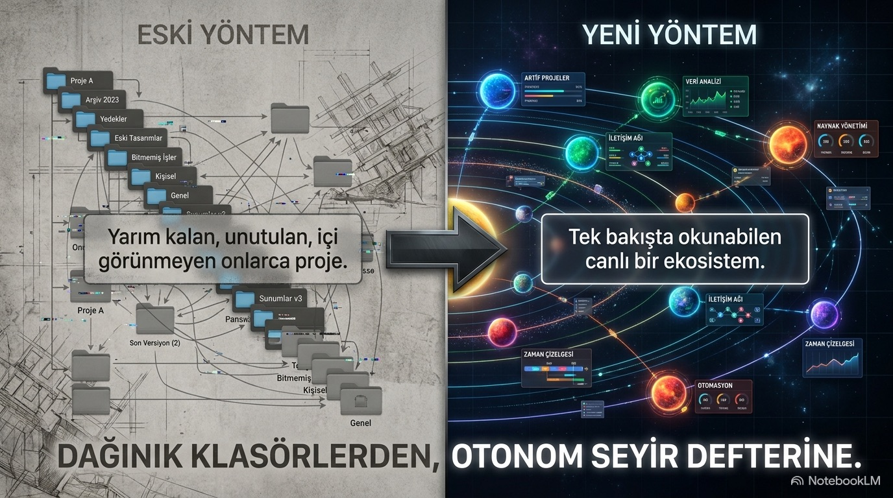</p>

Diskinde onlarca proje klasörü var: kimi yarım, kimi bitmiş, kiminde ne kaldığını hatırlamıyorsun bile. Project Galaxy bu klasörleri **yaşayan bir evrene** çevirir ve üstüne günlük geliştirme için ihtiyacın olan araçları (terminal, Claude, git, DB, Docker, uzak sunucu, zamanlayıcı) **tek pencerede** toplar:

- Her git deposu bir **gezegen** olur — rengi durumunu, halkası ilerlemesini, konumu son aktivitesini gösterir.
- Gezegene "inersin": solda **Ağaç**, ortada dosya önizlemesi (isteğe bağlı **Yörünge**), sağda daraltılabilir README, altta **projeye özel, kalıcı** bir terminal (bash + Claude).
- **5 kişisel AI ajanın** (CTO, PM, Dokümantasyoncu, Kod Denetçisi, Koç) projelerinin gerçek durumunu görerek rapor verir, README yazar, hesap sorar.
- Notların, todo'ların, günlüğün — hepsi projelere bağlanır ve README dosyalarına **senin onayınla** işlenir.
- Verilerin hiçbir sunucuya gitmez — her şey diskinde, git + yedeklerle güvende.

---

## Kurulum

**En kolayı:** [GitHub Releases](https://github.com/digitsontr/project-galaxy/releases)’ten hazır kurucuyu indir (macOS `.dmg`, Windows `.exe`). Aşağısı kaynak koddan kurmak isteyenler için.

### Gerekenler

| | Zorunlu mu | Neden |
|---|---|---|
| **Node.js 20+** ([nodejs.org](https://nodejs.org), LTS) | Evet | Uygulamayı kurar ve çalıştırır |
| **git** | Evet | Projeler git deposu olarak bulunur. macOS’ta `xcode-select --install` git + python3’ü birlikte kurar |
| **python3** (macOS/Linux) | Gömülü terminal için | `>_ TERMİNAL` sekmesi gerçek bir tty için kullanır. macOS’ta yukarıdaki komutla gelir |
| [Claude Code](https://docs.anthropic.com/en/docs/claude-code) | Hayır | ⌁ CLAUDE konsolu ve uzman ajanlar. Yoksa ✦ AJAN, Geliştir sekmesine girilen Anthropic API anahtarıyla çalışır |
| Docker Desktop, SSH anahtarı | Hayır | Yalnız ilgili sekmeler için |
| [Git for Windows](https://gitforwindows.org) | Windows’ta terminal için | Gömülü bash |

### Kaynaktan çalıştır (2 komut)

```bash
git clone https://github.com/digitsontr/project-galaxy.git
cd project-galaxy
npm install
npm start
```

`npm start` arayüzü (`newui/index.html`) derleyip uygulamayı açar. macOS’ta bunun yerine **`Başlat.command`**’a çift tıklayabilirsin (ilk seferde `npm install`’ı kendisi yapar).

İsteğe bağlı Claude Code:

```bash
npm install -g @anthropic-ai/claude-code
claude   # ilk çalıştırmada hesabınla giriş yapar
```

### Uygulama olarak paketle

- **macOS (kişisel .app):** **`create_app.command`**’a çift tıkla (“tanımlanamayan geliştirici” derse sağ tık → Aç). Bağımlılıkları kurar, arayüzü derler, smoke testi koşar ve bir üst klasöre ad-hoc imzalı **Project Galaxy.app** koyar. Sonraki kod güncellemelerinde tam paketleme yerine **`Yenile.app.command`** yeter.
- **macOS (dağıtım DMG):** `npm run dist` — imza/notarize için `docs/RELEASE.md`.
- **Windows:** `npm run dist:win` → `dist/Project-Galaxy-Setup-<sürüm>.exe` (NSIS). Ayrıntı: `docs/WINDOWS.md`.

### İlk açılış

Uygulama seni **bir defalığına tanır**: dil (TR/EN), adın, çalışma alanı klasörlerin (her biri bir evren) ve ajanların. Hepsi sonradan **⚙ Ayarlar**’dan değişir.

Evren **boş başlar** — altındaki depolar kendiliğinden gezegen olmaz. Projeleri sen eklersin: sol raydaki **＋ Ekle** (ya da evren kartındaki ＋) → yolu yaz (satır başına bir yol, `~` olur), **Klasör seç…** ile çoklu seç ya da **Depoları bul** ile bir klasörün altındaki git depolarını listeleyip işaretle. Evren kökü dışındaki klasörler de eklenebilir. Verin kod klasöründe değil, `~/Library/Application Support/ProjectGalaxy/` (Windows: `%APPDATA%\ProjectGalaxy\`) altında durur.

### Geliştirirken

| Komut | Ne yapar |
|---|---|
| `npm start` | Arayüzü derler + uygulamayı açar |
| `npm run build:ui` | Yalnız `newui/index.html`’i yeniden üretir |
| `npm test` | Derler + headless Electron smoke testi (CI’daki ile aynı) |
| `npm run test:integration` | Gerçek git/dosya/ajan motoru testleri (`GALAXY_IT_CLAUDE=1`, `GALAXY_IT_MSSQL=1` ile canlı servisler) |

Arayüzü düzenlerken `newui/index.html`’e **dokunma** — üretilmiş dosyadır ve git’te tutulmaz. Şablon `newui/preview-sample.html`, mantık `newui/parts/*.js`.

---

## Terminoloji — galaksi · yıldız sistemi · gezegen

<p align="center">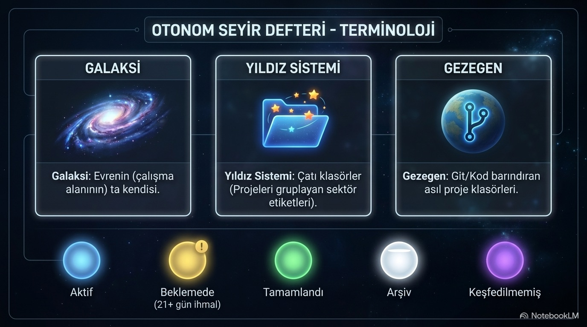</p>

| Kavram | Karşılığı |
|--------|-----------|
| **Galaksi** | Evrenin (çalışma alanının) kendisi — seçtiğin bir kök klasör. |
| **Yıldız sistemi** | Evren kökünün altındaki çatı klasör. Eklediğin proje bunun içindeyse (ör. `kök/mobil/app`) grup etiketi `mobil` olur. |
| **Gezegen** | Evrene **senin eklediğin** proje klasörü. |

> **Önemli:** Evrene yalnızca **eklediğin** klasörler gezegen olur; kökün altında yeni bir depo açman haritayı değiştirmez. Git şart değil ama önerilir (dal, kirli dosya, PR bilgisi git'ten gelir). Bir gezegeni **evrenden çıkarmak** klasöre dokunmaz; aynı yolu tekrar eklersen notu/planı geri gelir.

**Gezegen durumu (renk):** 🔵 aktif · 🟡 beklemede · 🟢 tamamlandı · ⚪ arşiv · 🟣 keşfedilmemiş.

---

## Arayüz turu

<p align="center">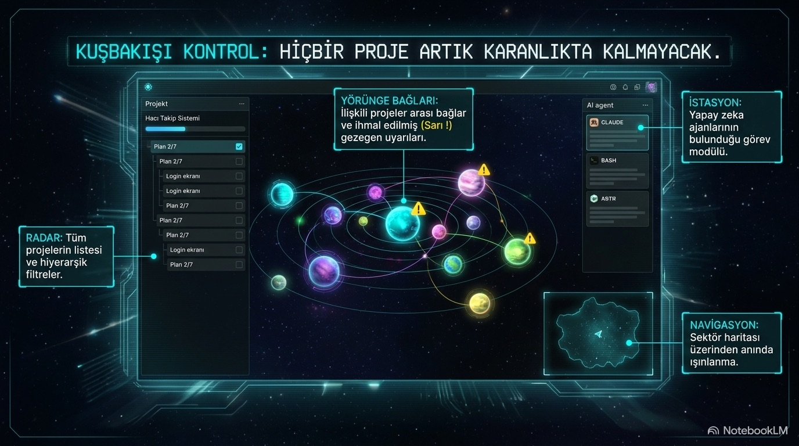</p>
<p align="center">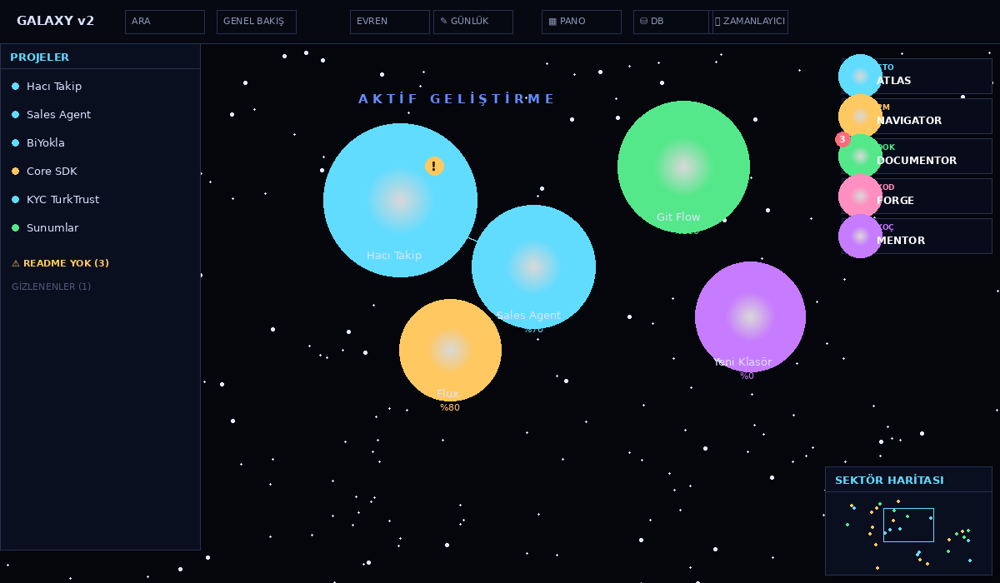</p>

### Üst bar & navigasyon

Soldan sağa:

- **KAPTAN** markası + **durum noktası** (hazır / çalışıyor / hata) · gezegen modundayken **‹** (uzaya dön) düğmesi.
- **Konum breadcrumb'ı** — **🌌 Evren › 🪐 Gezegen ▾**. Tıkla → hızlı geçiş: üstte tüm **evrenler**, altta o evrenin **gezegenleri**. Tek tıkla başka evrene/projeye geç.
- **Ana menü** — **Ana Sayfa · Görevler · Ajanlar · Otomasyonlar · Servisler**. Gruplu bölümlerin altında alt sekmeler var: Ana Sayfa → Bugün, Projeler · Otomasyonlar → Zamanlanmış işler, Proje taraması, E-posta · Servisler → Veritabanları, Konteynerler, SSH sunucuları. Her bölüm son açtığın alt sekmeyi hatırlar.
- **Kaptan** — dijital ikiz (asistan) her zaman üst barda.
- **◷ Saat** — tıkla → **İstasyon Araçları**. **⌘K** — komut paleti. **⚙ Ayarlar**.

Ekran 3 kolondur: sol (ağaç / git), orta (iş), sağ **bağlam** (nerede kaldın + hızlı atlamalar). Kapalı bir ray, imleç ekran kenarına yaklaşınca açılır; ◀▶ ile sabitlenir.

### İstasyon Araçları

Üst bardaki **Daha ▾ → İstasyon** (veya saat):

- **Canlı saat + tam tarih**
- **Hızlı ara** — gezegen ada göre; seçince iner

`Esc` ile kapanır. Komut paleti (⌘K) ayrıdır.

### Uzay modu — galaksi haritası

- **Galaksi görseli:** fareyle sürükle, tekerlekle yaklaş. WASD/oklar + / − ile de gezinilir.
- **Sol panel — PROJELER:** aktif evrenin gezegenleri, **son aktiviteye göre sıralı** (en taze üstte). Her satır: durum noktası + proje adı + **dal ve son aktivite** (`main · 2g önce`). **Tek tık seçer, inmez;** **j / k** ile listede gez, **Enter** · **İn** · çift tık ile inersin. Evren boşsa **Evren bağla** tek CTA.
- **Sağ istasyon:** 5 AI ajanın avatarları (üzerine gel → görev kartı, tıkla → sohbet).
- **GALAXY HUD (alt):** Üç kart: **En Aktif Yıldız** (son 30 günde en çok commit alan projen), **Son Yapılanlar** (+ RAPOR arşivi), **Notlarım** (hızlı not ekle). Panel taşarsa iç kısmı kaydırılır; içerik asla kırpılmaz.

### Gezegen modu — projenin içi

<p align="center">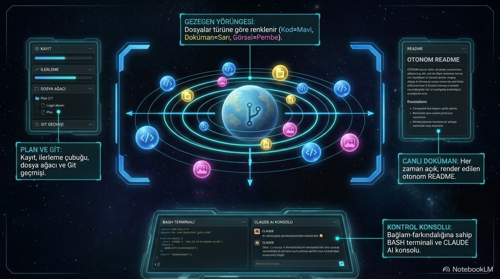</p>
<p align="center">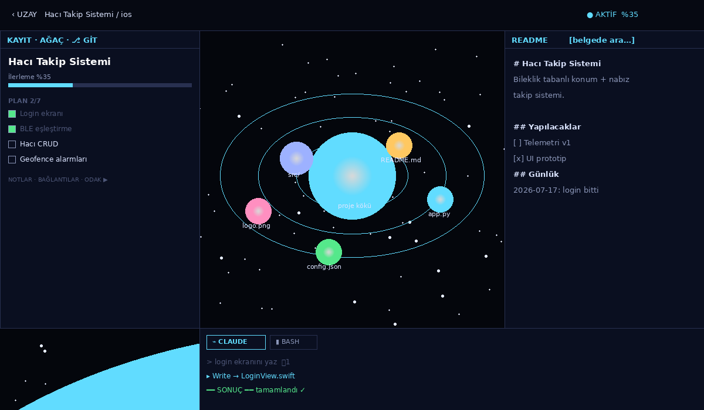</p>

- **Orta — atölye:** varsayılan **Dosya** görünümü; soldaki ağaçtan tıklanan dosya burada açılır (kod, markdown, resim, PDF, video). **Yörünge** anahtarı eski uydu haritasını geri getirir (klasör = halkalı uydu, dosya = türe göre renk).
- **Gezegene inince (dosya açık değilken):**
  - **Veri katmanı** kartı projenin veritabanlarını gösterir. Kaynaklar: `.env`, compose, Prisma şeması, sürücü paketleri, koddaki SQL/ORM kullanımı.
  - Bağlı bir bağlantı varsa canlı durumu ve tablolarını da gösterir; tabloya tıklayınca DB sekmesinde açılır. Bağlı değilse **Bağla** ile `.env`'den kurulur.
  - **Proje haritası** kartı dosya, satır, modül, rota ve IPC özetini verir.
- **⤢ Akış şeması (tam ekran):** proje kodu çalıştırılmadan okunur ve soldan sağa akan bir şema çizilir. Sıra: giriş noktaları (`npm` script'leri, `main`, `__main__`, HTML `<script>`), klasör modülleri, veritabanları ve dış servisler (Stripe, OpenAI, fetch edilen hostlar…).
  - **Oklar:** import, Electron IPC / `contextBridge`, ön yüzden API rotasına giden HTTP çağrısı, DB erişimi.
  - **Düğüme tıklayınca:** dosyalar, rotalar (dosya:satır), IPC kanalları, dokunduğu tablolar, bağımlı olduğu ve onu kullanan modüller görünür.
  - **Çift tık:** modülün içine iner (dosya düzeyinde şema) ya da dosyayı açar.
  - Arama, yakınlaştırma ve kaydırma var; **Esc** bir üst seviyeye çıkar.
- **Sol panel, üç sekme (varsayılan Ağaç):**
  - **Ağaç** — tam dosya ağacı + projede ara (grep).
  - **Kayıt** — durum, ilerleme, plan checklist'i (**tek tıkla** tamam/beklemede), notlar, **odak kronometresi** (süresi Ayarlar'dan), onaylı proje kaldırma, klasörü aç.
  - **Git** — canlı git paneli (aşağıda).
- **Sağ panel:** README; **‹** veya **⌘\\** ile gizlenir, dikey şeritten geri açılır. İçinde ara.
- **Alt konsol:** projeye özel, kalıcı terminal; üst kenarından sürükleyerek yükseklik (en az 240px, hatırlanır).

### Konsol — kalıcı bash + Claude oturumları

Alt kısımda, **başlıklı ayrı bir panel** olarak durur: **▮ TERMİNAL · \<proje\>** + `CLAUDE` / `BASH` sekmeleri + sağda **● oturum sürüyor** (canlı nabız). Giriş alanında **yanıp sönen imleç** komut beklediğini belli eder.

- **⌁ CLAUDE** — "şu bug'ı düzelt" yaz, Enter. Bu projenin klasöründe çalışır; dosya okur/yazar, komut çalıştırır. Oturum `claude --continue` ile sürer (kaldığın yerden devam). Ekran görüntüsü yapıştır (⌘V) ya da dosya sürükle.
- **▮ BASH** — gömülü terminal. `cd` / ortam değişkenleri oturum boyunca korunur, Tab ile tamamlama, ↑↓ komut geçmişi, ⇗ ile gerçek Terminal/iTerm'de aç.

> **Oturumlar projeye özel ve KALICI:** Bir projede komut çalıştırıp başka projeye geçtiğinde önceki oturum kapanmaz. Geri döndüğünde bash çıktın ve Claude sohbetin **kaldığın yerde** durur — her projenin kendi bağımsız oturumu vardır. Konsol tutamağını sürükleyerek yüksekliğini ayarlayabilirsin.

### 🔮 Galaxy Asistanı — dijital ikizin

Ekranın **sağ istasyon** sütununun altında parçacıklı bir **asistan orbu** durur (ajan açıkken küçük nokta). Tıkla → 380px yazışma paneli açılır. Bu bir **dijital ikiz**: robotik bir komut kutusu değil, **insan gibi konuşan** kişisel asistan. Hem sohbet eder hem de projede yaptığın her şeyi **yazarak** yaptırır. Ajan paneli açıkken ikiz kapanır — aynı anda tek sohbet.

- **Yazışarak konuş:** panele yaz, Enter'a bas. Yanıt **token token akar** (hece hece yazılır gibi). Cevaplar panelde kalır; oturum kaldığın yerden sürer.
- **Durum renkleri** — orb yaptığı işe göre renk değiştirir: **cyan** hazır · **mavi** çalışıyor.
- **Tam yetkili** — projede/uygulamada yapabileceğin her şeyi yaptırabilirsin:
  - **Gezinme:** "Core SDK projesine git", "Papilon evrenini aç", "uzaya dön".
  - **Sekme:** "Docker'ı aç", "veritabanını aç", "pano".
  - **Git:** "commit et [mesaj]", "push", "pull", "git durumu".
  - **Terminal:** "terminalde npm test çalıştır" → o projenin bash'inde çalıştırır, çıktıyı gösterir.
  - **Geliştirme + genel bilgi:** "login ekranındaki hatayı düzelt" ya da "bugün Ankara'da hava kaç derece" — kod işini yapar, genel soruları da (web araması dahil, tam izinli) yanıtlar.
- **Kalıcı hafıza:** sohbet geçmişi diske kaydedilir — uygulamayı kapatıp açsan da kaldığın yerden devam eder. Başlıktaki **✎** ile "yeni sohbet" başlatırsın (geçmiş + Claude oturumu sıfırlanır).
- **Kişilik / dijital ikiz:** Ayarlar → "Asistan kişiliği / hakkında" alanına kendini yaz (kim olduğun, tarzın, tercihlerin) → ikiz senin gibi konuşur.
- **Günlük brifing:** her gün ilk açılışta ikiz sana kısa bir durum özeti verir (ne durgun, ne bekliyor, bugün neye odaklan). İstediğinde "brifing" / "durum raporu" yaz.
- "Ne yapabilirsin?" dersen yeteneklerini sayar. `Esc` ile kapanır.

> Ses: mic / “Hey Galaxy” / Chat | Voice On arayüzde açık. Kota veya CLI yoksa ajan durur; hata metni SQL gibi çalıştırılmaz.

### GİT — tek kapı

Git'e giden tek yer sol paneldeki **⎇ Git** sekmesidir (aktivite çubuğu, sağ bağlam ve Kaptan komutları da oraya açar):

- **Durum kartı:** dal, **ahead/behind** (`↑2 ↓0`), "N değişiklik bekliyor / çalışma alanı temiz".
- **Tek birincil düğme:** kirliyse **Commit…**, temiz+ahead ise **Push**, temiz+behind ise **Pull**, aksi **Güncel**. Push öncesi uygulama içi onay; bitince kısa bir sonuç bildirimi (örn. `main ← 2 commit`). Git deposu değilse tek düğme **git init**.

Commit ekranı dört bölümlü bir tezgah içinde açılır:

- **DURUM** — dal değiştir/oluştur, dosyaları stage/unstage et, commit mesajı yaz → commit.
- **TAKIM AKIŞI** — senin o andaki gerçek durumuna göre (dal, bekleyen değişiklik, `develop` var mı) yazılan adım adım teslim akışı: gerekiyorsa `git stash` ile işini kaybetmeden feature dalına taşı, `feature/…` adı öner, küçük commit → `push -u` → **MR/PR aç** (kopyalanabilir açıklama şablonu) → rebase + `--force-with-lease` → birleştir + dal temizliği. Her komut kutusu tıklayınca panoya kopyalanır.
- **GEÇMİŞ** — günlere gruplu commit zaman çizelgesi + kim ne kadar katkı yapmış.
- **GIT FLOW REHBERİ** — git'i hiç bilmeyen biri için: şerit diyagramı (main/develop/feature/release/hotfix) + 6 adımda tüm döngü + kopyalanabilir komut sözlüğü (başlangıç, kaydetme, remote, geri alma, inceleme).

---

## Sekmeler

Üst bardaki segmentli çubuktan erişilir. Bir sekmeye geçince ilgili veri **otomatik tazelenir**.

### ▦ PANO — Kanban

Tüm todo'lar üç kolonda: **Bekliyor / Devam / Tamam**. Karttan ▸ GİT ile gezegene in, ⌁ ile Claude aç.

### ⛁ DB — Veritabanı gezgini

Postgres / MySQL / SQLite sunucularını ekle (parolalar macOS `safeStorage` ile şifreli) → sunucudaki tüm veritabanları → tablolar → satırlar. **Satır düzenle / ekle / sil**, **CSV dışa aktar**, **ŞEMA** düğmesiyle foreign key ilişkilerini kart diyagramı olarak çiz. Serbest SQL çalıştır: `SELECT` doğrudan çalışır; yazma işlemleri (INSERT/UPDATE/DELETE) **önce onay** ister ve denetim günlüğüne (🤖 ajan onaylıysa etiketle) yazılır.

### 🐳 DOCKER

- **Konteynerler:** çalışan + durmuş hepsi listelenir; **başlat / durdur / yeniden başlat / kaldır**, **canlı log akışı** ve konteyner içinde **komut çalıştır** (exec). Sekmeye her geçişte liste tazelenir; konteyner yoksa açıkça belirtilir.
- **İmajlar:** listele + sil.
- Motor kapalıysa **▸ Başlat** ile Docker Desktop'ı aç; `prune` ile temizle.

### ⏱ ZAMANLAYICI

"Her sabah 09:00'da Kod Kalitesi ajanı rapor hazırlasın" gibi görevler tanımla (haftalık/günlük, ajan seç). Görev çalışınca **çıktısı ekranda görünür**, rapor arşivine (`reports/`) düşer ve hangi sekmede olursan ol bildirim (toast) çıkar. ▸ ÇALIŞTIR ile elle de tetiklenir.

### 🖧 SUNUCULAR — Uzak / SSH

<p align="center">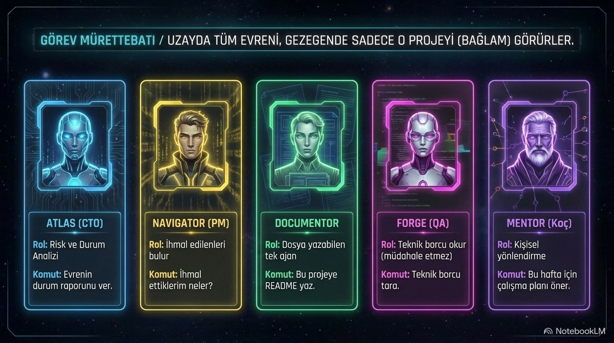</p>

- **Sunucu ekle/düzenle:** ad, host, kullanıcı, port, **anahtar seçici** (`~/.ssh` altındaki gerçek anahtarlar çip olarak listelenir). **Test et** bağlantıyı ve uzak kabuğu (POSIX/Windows) doğrular.
- **Uzak klasör → evren:** sunucudaki bir yolu (ör. `/root`, `/home/kullanıcı/projeler`) yaz → o klasör **uzak evren** olur ve boş başlar; arka plandaki tarama (stale-while-revalidate önbellek) bulduğu depoları **＋ Ekle** penceresinde listeler, istediklerini işaretleyip eklersin.
- **Uzak terminal:** sunucuda gömülü terminal — **login kabuk** (`bash -l`) kullanır; böylece uzak `PATH` senin kendi terminalindekiyle aynıdır (docker/node/nvm/brew komutları bulunur).
- ControlMaster multiplexing, `accept-new` host-key politikası, yapılandırılabilir zaman aşımı (Ayarlar).

### 🎓 EĞİTİMLERİM — yerel ders materyalleri

Varsayılan kök `~/Desktop/FY/software-practice` (yoksa `~/Desktop/yazılım`). .NET müfredatı, Python alıştırmaları, laboratuvarlar ve notlar parkur olarak sınıflandırılır; Markdown/metin dersleri okunur. Kaynağa dokunmaz; yalnız dönüşüm önbelleği tutar (`lib/trainings.js`).

- **Kategori → ders → okuma paneli:** sol iki sütun klasör adına göre kategorize edilmiş dersleri listeler (C#, Java, Python, React, Yapay Zeka…), sağdaki panel seçilen dersi düzenli tipografiyle gösterir. Word'ün doğrudan kalınlık yanında **stil-referanslı** ("Strong" vb.) kalınlıkları da tanır, numaralı müfredat konuları ile alt etiketleri iki ayrı seviyede (h3/h4) gösterir — belgeler arası tutarlı bir okuma standardı.
- **Desteklenen türler:** `.docx`, `.pptx` (slayt slayt), isimsiz Colab/Jupyter defterleri (markdown hücreleri + kod + çıktı + grafik görselleri — Colab'a yapıştırılan görseller dahil), `.py` kaynak dosyaları. `.zip` arşivleri içerik olarak açılmaz, **Finder’da göster** ile erişilir.
- **Belge ekle/sil:** "+ Belge Ekle" ile mevcut ya da yeni bir kategoriye dosya eklenir (kopyalanır); her dersin yanındaki ✕ ile silinir (kalıcı değil, Çöp Kutusu'na taşınır).
- **Sınav modu:** üstteki Oku/Sınav geçişiyle açılır — tüm derslerden rastgele sorar. Okuma panelindeki **🎯 Bu dersten pratik yap** ise o dersin tüm sorularını sırayla sunar ("Soru 2/6"), set bitince skorla tamamlanma ekranı + tekrar dene seçeneği gelir. Sorular Claude ile (henüz üretilmemişse) 6 adet çoktan seçmeli olarak üretilip dosya değişmediği sürece kalıcı önbellekte tutulur. Cevap seçilince doğru/yanlış renklenir, açıklama + skor gelir.

---

## Yapay zekâ ajanların

<p align="center">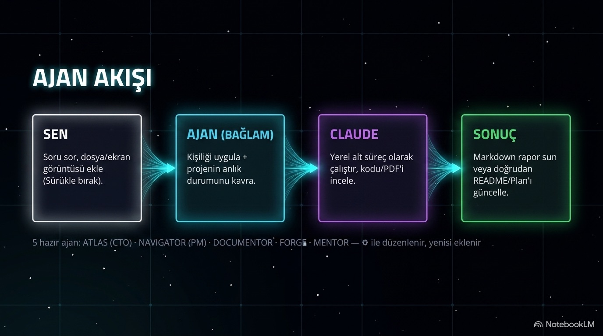</p>

**Kaptan** (üst bar) senin dijital ikizin: seni birebir temsil eder, beş uzmanın tüm yeteneklerine hâkimdir, küçük işi kendisi yapar, büyük işi uzmana devreder (`[[ACT open_agent|…]]`) ya da toplantı açar. Kalıcı hafızası `DATA_DIR/twin/facts.json`'dadır; tercihlerini ve kararlarını öğrendikçe kaydeder. Sesli konuşmada kısa, yazılı konuşmada gerektiği kadar derin cevap verir.

Yerleşik ekip (ilk kurulumda "Ekibini seç" adımında listelenir, sonra **Ajanlar → Toplantı Salonu**'ndan duraklatılır, silinir ya da geri eklenir):

| Ajan | Ne yapar | Yetki |
|------|----------|-------|
| **Git Yöneticisi** | Yerel + uzak dallar, commit, stash, PR/MR; dal grafiğini çizer, adım adım anlatır | `git`, `gh`, `glab`; geri alınamaz işlemden önce onay ister |
| **Kod Kalitesi** | Dili/framework'ü tanır, code review + SonarQube kategorileriyle `dosya:satır` bulgular, kalite kapısı kararı | Sadece okur |
| **Dokümantasyon** | md, pdf, xlsx/csv, görsel/SVG dokümanları bulur, üretir, iyileştirir | Dosya yazar; üzerine yazmadan sorar |
| **Akış Analisti** | Her akışı aşamalarıyla çıkarır; sorunları ve git geçmişinden nasıl çözüldüklerini gösterir | Sadece okur |
| **Planlayıcı** | Fikri sorgular, MVP ve riskleri çıkarır, 3-4 alternatif plan + uzun proje promptu yazar | Sadece okur |

**Toplantı Salonu** (Ajanlar sekmesi): ekip kartları; **Konuş** ile ajan tam ekran çalışma alanında açılır (solda yetenekler ve hızlı işler, ortada sohbet). **Toplantı masası**na bir konu yazıp katılımcıları seçersen ajanlar sırayla, birbirini görerek konuşur; sonunda Kaptan kararları ve yapılacakları özetler. Geçmiş toplantılar saklanır. Ajanlar uzaydayken tüm projelere, bir projeye girdiğinde yalnız o projeye bakar. Eski ATLAS/NAVIGATOR/… ekibi ilk açılışta `backups/agents-v1.json`'a yedeklenir; kendi oluşturduğun ajanlar korunur.

### Günlük iş akışın (Otonom README döngüsü)

<p align="center">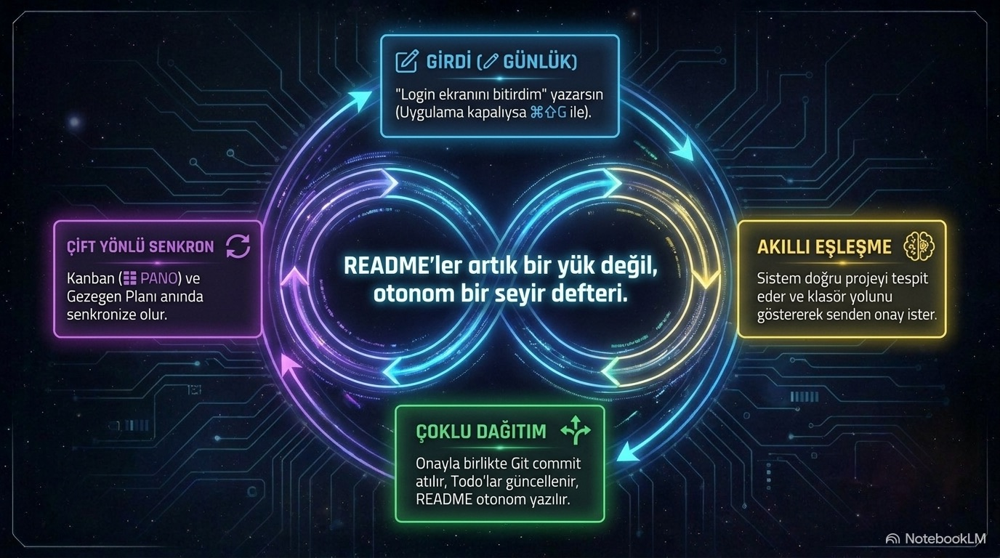</p>

**✎ GÜNLÜK:** "login ekranını bitirdim" yaz → uygulama hangi projeyle ilgili olduğunu bulur → **klasör yolunu göstererek onayını ister** → yapılan iş README `## Günlük`e, yapılacak iş `## Yapılacaklar`a ve plana işlenir. README'deki `- [ ]` maddeleri gezegene girince plana aktarılır — çift yönlü senkron. **⌘⇧G** ile uygulama kapalıyken menü çubuğundan hızlı not.

---

## Ayarlar

⚙ (HUD dişlisi / tray / ⌘K) — artık yalnız profil değil, gerçek araç yapılandırması:

| Ayar | Ne işe yarar |
|------|--------------|
| **Ad / Hitap** | Ajanların sana seslenişi. |
| **Dil** | TR / EN (arayüz + ajan varsayılanları). |
| **İhmal uyarısı (gün)** | Bu süreden eski aktif projeler uyarı üretir. |
| **Plan uyarısı (madde)** | Bekleyen plan maddesi eşiği. |
| **Claude komut yolu** | Boşsa PATH'ten; ya da tam yol (ör. `/opt/homebrew/bin/claude`). Tüm Claude çağrılarına uygulanır. |
| **Terminal uygulaması** | Terminal.app / iTerm — "gerçek terminalde aç" bunu kullanır. |
| **Odak süresi (dk)** | Pomodoro kronometresinin varsayılanı. |
| **SSH zaman aşımı (sn)** | Uzak bağlantı `ConnectTimeout`. |
| **Asistan kişiliği / hakkında** | Dijital ikizine kendini tanıt — senin tarzınla konuşsun. |

Yedeklerden geri dönüş: ⌘K → Yedekler.

---

## Kısayollar

<p align="center">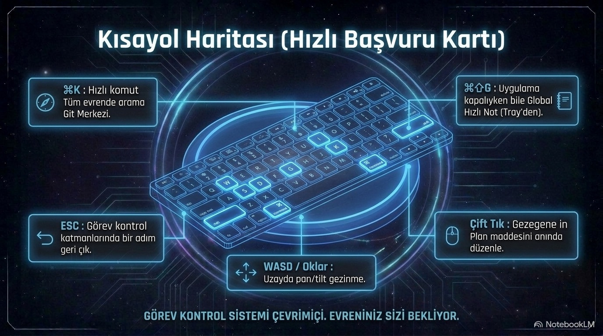</p>

| | |
|---|---|
| **F1** / **⌘/** | Seyir Rehberi (görselli tanıtım + kullanım) |
| **⌘K** | Komut paleti: proje ara, git, ayarlar, yedekler |
| **Daha ▾ → İstasyon** | Saat · hızlı ara |
| **🌌 breadcrumb** | Konum switcher: evren/gezegen değiştir |
| **j / k** | Uzayda gezegen listesinde seç (**Enter** = in) · palette **↑↓** |
| **ESC** | Katman katman geri (araçlar → switcher → paneller → uzay) |
| **Enter** | Gönder/çalıştır · **Shift+Enter** yeni satır · **⌘Enter** commit |
| **⌘⇧G** | Her yerden hızlı not |
| **⌘\\** | Gezegende README gizle / göster |
| **Çift tık** | Haritada gezegene in |
| **Tek tık** | Plan maddesi tamam / beklemede |
| **↑ ↓** | Bash komut geçmişi · **Tab** tamamlama · **⌫** üst klasör |
| **WASD / oklar, + / −, ⌂** | Uzayda gezinme |

---

## Verilerim güvende mi?

<p align="center">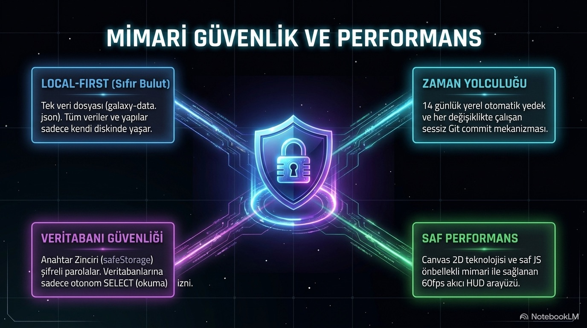</p>

- **Kodun ve notların diskinde:** tek veri dosyası `galaxy-data.json`, konum macOS’ta `~/Library/Application Support/ProjectGalaxy/`, Windows’ta `%APPDATA%\ProjectGalaxy\`. Uygulama kendi bulutunu işletmez; yedek `backups/` altında yereldir.
- **Model çağrıları dışarı çıkar:** ajanlar ve dijital ikiz Claude Code CLI üzerinden çalışır (sohbet, web araması, dosya/terminal). “Hiçbir paket internete gitmez” iddiası yok — dürüst söz: **senin repoların yerelde kalır, dil modeli senin Claude hesabınla konuşur.**
- Her gün otomatik yedek (`backups/`, 14 gün) + her değişiklikte sessiz **git commit** — `git log` ile zaman yolculuğu.
- Gezegen kaldırma uygulama içi onay kartıyla **galaksiden gizler**; klasör diskte kalır (Gizlenenler’den geri alınır). Eski native üç seçenekli diyalog (`projectDelete`) hâlâ IPC’de durur ama arayüz gizlemeyi kullanır.
- DB parolaları `safeStorage` ile şifrelenir; DB yazma işlemleri onaylı ve denetim günlüğüne yazılır.
- SSH anahtarların uygulamaya kopyalanmaz — `~/.ssh` altındakiler doğrudan kullanılır; verilen anahtar dosyası yoksa ssh-agent'a düşülür.

---

## Sık sorulanlar

**Uygulama açılmıyor / "Apple could not verify…" diyor.** İmzasız (ad-hoc) derleme olduğu için macOS engelliyor — normaldir. **Move to Trash deme, Done de.** Sonra Terminal'de karantinayı temizle (tek seferlik):
```bash
xattr -cr /Applications/"Project Galaxy.app"    # ya da ~/Downloads/"Project Galaxy.app"
```
Terminal istemezsen: **Sistem Ayarları → Gizlilik ve Güvenlik** → aşağıda *"engellendi"* → **Yine de Aç**. (macOS 15'te eski "sağ tık → Aç" çalışmaz.) Ayrıca `node -v` / `bun -v` ile motorun kurulu olduğunu doğrula.

**Ajanlar / ⌁ CLAUDE "claude bulunamadı" diyor.** Kurulum Adım 2'yi yap; `claude` yazıp giriş yaptığından emin ol. Gerekirse **Ayarlar → Claude komut yolu**'na tam yolu gir.

**Evrenin altına açtığım yeni proje görünmüyor.** Kasıtlı: projeler kendiliğinden eklenmez. Sol raydaki **＋ Ekle** ile yolunu gir ya da **Depoları bul**'dan işaretle.

**Güncellemeden sonra projelerim duruyor mu?** Evet. Eski bir evren ilk açılışta bir kez taşınır: o an görünen projeler üye olarak kaydedilir (gizlediklerin hariç). Bundan sonra yeni depolar otomatik gelmez.

**Docker konteynerlerim listelenmiyor.** DOCKER sekmesine geç (açılışta tazelenir) ya da **⟳ Yenile**'ye bas. Gerçekten konteyner yoksa panel bunu açıkça yazar. Motor kapalıysa **▸ Başlat**.

**Uzak sunucuya bağlanamıyorum / komutlar bulunamıyor.** Sunucu **Test et** ile doğrulanıyor mu? Uzak terminal login kabuk kullanır; yine de eksik komut olursa sunucudaki `~/.bash_profile` PATH'ini kontrol et. Anahtar alanına **host adı değil, `~/.ssh` altındaki gerçek anahtar dosyası** yazılmalı (çipe tıkla).

**Terminalde önceki oturumum kayboluyor mu?** Hayır — oturumlar projeye özel ve kalıcıdır. Projeler arası geçince kaldığın yerden devam edersin.

**vim/top gömülü terminalde çalışmıyor.** Doğru — o bir komut yürütücü; tam ekran programlar için ⇗ ile gerçek Terminal'i aç.

**Onboarding'i tekrar görmek istiyorum.** `galaxy-data.json` içindeki `"profile"` bölümünü sil, uygulamayı yeniden aç.

**App Store sürümüyle DMG sürümü arasındaki fark ne?** App Store (MAS) sürümü Apple sandbox'ı içinde çalışır: ajanlar, ⌁ CLAUDE, ▮ BASH, Docker ve SSH orada devre dışıdır; harita, gezegen modu, git panelleri, todo/pano ve DB görüntüleyici çalışır. Tüm özellikler için DMG (doğrudan indirilen) sürümü kullan. Ayrıntı: `docs/RELEASE.md`.

---

## Klasör yapısı & mimari (meraklısına)

```
ProjectGalaxy/                       (kod)
├── main.js                          # Electron ana süreç: pencere, tray, güncelleme; modülleri sırayla yükler
├── preload.js                       # Arayüze açılan güvenli köprü (window.galaxy.*)
├── lib/                             # Paylaşılan çekirdek (main.js'in `g` nesnesine eklenir, sıra önemli)
│   ├── config.js                    #   veri klasörü, PATH, eski veri taşıma, MAS izinleri
│   ├── data.js                      #   galaxy-data.json, yedek + otomatik commit, ayarlar, Claude keşfi
│   ├── projects.js                  #   evren tarama → gezegenler, knownPaths (izinli yollar)
│   ├── planet-work.js               #   proje bağlamı: .env anahtarları, compose, script, migrate
│   ├── project-map.js               #   proje haritası: giriş → modül → rota/IPC → veri → dış servis (akış şeması)
│   ├── cli.js                       #   platformdan bağımsız CLI çağrısı (Windows .cmd → gömülü Node)
│   ├── mcp-client.js                #   MCP stdio istemcisi (posta vb.)
│   └── trainings.js                 #   Eğitimlerim: docx/pptx/ipynb okuma
├── ipc/                             # Arayüzün çağırdığı IPC kanalları
│   ├── core.js                      #   evren/proje, dosya ağacı ve dosya CRUD, todo, README, Ayarlar
│   ├── db-git.js                    #   Postgres/MySQL/SQLite/SQL Server + git işlemleri
│   ├── ai-runtime.js                #   Claude CLI, dijital ikiz, ses, ajanlar, bash/SSH kabukları, zamanlayıcı
│   ├── infra.js                     #   SSH sunucuları + Docker
│   ├── planet-work.js               #   gezegen bağlamı, PR/CI/issue (gh), evren trafiği/grep
│   ├── devtools.js                  #   gerçek PTY terminal, dosya izleme, tanılama, LSP, debug, işler
│   ├── agent-engine.js              #   yerleşik ajan motoru (CLI ya da API anahtarı)
│   ├── pty-host.py                  #   PTY köprüsü (python pty.spawn) — terminal sekmesi
│   ├── lang-worker.js, scan-worker.js  # worker thread'ler: TypeScript dil servisi, toplu arama, proje haritası
├── newui/                           # Uygulamanın yüklediği arayüz
│   ├── preview-sample.html          #   şablon (dc template sözdizimi) + stiller
│   ├── parts/00-…80-*.js            #   tek `class Component`'in sıralı dilimleri (tek başına geçerli JS değil)
│   ├── build.js                     #   derleyici: şablon + parts → index.html
│   ├── index.html                   #   ÜRETİLİR, git'te yok — elle düzenleme
│   └── vendor/                      #   three.js, react, dc-runtime, codemirror, xterm (gömülü kopyalar)
├── onboarding.html                  # İlk açılış + Ayarlar penceresi (?mode=settings)
├── native/galaxy-stt.swift          # macOS ses tanıma yardımcısı (paketlerken derlenir)
├── test/                            # smoke.js (headless UI) + mock-preload.js + integration.js
├── scripts/                         # package-mac.sh, refresh-app.sh, build-mas.js
├── assets/guide/                    # Onboarding/rehber görselleri
├── docs/                            # OZELLIKLER, RELEASE, WINDOWS, REMOTE-SSH, PRIVACY…
├── build/                           # ikon, tray, entitlements (DMG + MAS)
├── Başlat.command                   # kaynaktan çalıştır (macOS çift tık)
├── create_app.command               # kişisel .app paketleyici
└── Yenile.app.command               # .app'e yalnız kodu kopyala (hızlı güncelleme)

~/Library/Application Support/ProjectGalaxy/   (veri — koddan ayrı yaşar)
├── galaxy-data.json                 # TÜM verin — tek kaynak
└── backups/  reports/  attachments/
```

**Teknik notlar:** Arayüz `dc-runtime` bileşen çatısıyla yazılır; `newui/build.js`, `preview-sample.html` + `parts/*.js`'ten `index.html` üretir. Galaksi arka planı WebGL (three.js) ile ayrı katmanda çizilir, bu yüzden arayüz yeniden render'ları 3D'yi etkilemez. Git bilgisi süreç başlatmadan `.git` dosyalarından okunur; ahead/behind `git rev-list` ile hesaplanır. Yerel/uzak kabuklar `SHELL_SENTINEL` ile komut bitişini yakalar; konsol çıktısı ve oturumları **proje bazlı** tutulur (`_consoles[pid]`, `_claudeSess[pid]`). DB sürücüleri saf JS (pg/mysql2/sql.js/mssql). Native ses tanıma `native/galaxy-stt.swift` (yalnız macOS). Windows gömülü terminal Git-Bash ister. Dağıtım: macOS DMG/zip (Developer ID + notarize), Windows NSIS, MAS sandbox kısıtlı.

---

## Yol haritası — günlük sürücü

Hedef: kişisel evren OS’undan, bir geliştiricinin **her sabah** Finder + Terminal + beş sekme yerine açtığı masa. Galaxy metaforu (gezegen, istasyon, ikiz) kalır. Apex / Gmail / “AI OS” kopyası değil.

### Konum — neyiz, ne değiliz

| Al | Bırak |
|----|--------|
| Kaldığın gezegen + dosyaya 1 tık dönüş | Her açılışta evren seçtirmek |
| Kirli git, ihmal, açık todo tek bakışta | Ajanda / CRM / gelen kutusu olmak |
| Cursor / VS Code / Finder köprüsü | Galaxy’yi tam IDE yapmak |
| 5 geliştirici ajanı + ikiz + DB ajanı | Satış / reklam / Instagram ajanları |
| Kota/hata metnini SQL sanmamak | CLI yokken sessizce patlamak |
| Odak bloğu, not, pano | Kişisel hayatın tamamını yönetmek |

### Faz A — masaya otur (şimdi)

- [x] Kadet kaldırıldı — tek tam görünüm
- [x] STT HUD (mic, Hey Galaxy, Chat \| Voice)
- [x] HTML dosyalar sahnede sayfa gibi
- [x] DB ajanı kota/hata metnini çalıştırmaz
- [x] Son evren / gezegen / dosya / sekmeyi hatırla
- [x] Özet: **kaldığın yer** + kirli git + stale gezegen + açık todo
- [x] **Editörde aç** (Cursor, yoksa VS Code, yoksa Finder)
- [x] ⌘K: “devam et”, “editörde aç”

### Faz D — nefes al (şimdi)

Üst çubuk ve yardım, karmaşıklığı keser. DB / Docker vitrin; ajan rayı değil.

- [x] Üst bar: **Özet · Evren · DB · Docker · Daha**
- [x] Her bölümde kapatılabilir yardım (“Anladım”)
- [x] Asistan üst barda; sağ İSTASYON varsayılan kapalı
- [x] Özet’ten DB / Docker kısayolu

### Faz E — ajanları evcilleştir

- [ ] Mağaza sürümünde ajan UI kapalı + dürüst boş durum
- [ ] Sideload’da Jarvis (ikiz) tek sohbet kapısı

### Faz B — akışı kısalt

- [ ] Kirli gezegene inince Git sekmesi açık
- [ ] Son 5 dosya / gezegen ⌘K’da
- [ ] Takım Akışı şablonunu `gh pr create`’e bağla
- [x] Özet’ten bugün masası (commit / ihmal / kaldığın yer) — takvim yok
- [ ] Tehlikeli işte tek onay kartı; kota mesajı ikizde de Türkçe

### Faz F — ücretsiz mağaza (Mac App Store + Microsoft Store)

Vitrin: harita, gezegen, git, pano, **DB**, **Docker**. Ajan / terminal sandbox’ta yok — sideload veya BYOK.

- [ ] Mağaza metni TR/EN: ajan vaat etme
- [ ] Ekran görüntüleri: ajan rayı kapalı
- [ ] Gizlilik metni: veri yerelde
- [ ] Claude API BYOK (store’da ajanın tek yolu)
- [ ] Microsoft Store appx
- [ ] MAS: Team ID + Transporter (`docs/APPSTORE.md`)
- [ ] Ana UI i18n TR/EN
- [ ] Boş evren turu: `git init` + ilk gezegen

Dağıtım detayı: `PRODUCTIZATION.md`.

---

## Sürüm notları — bu sürümde neler değişti

**v2.3.13 / 2.3.12** — Windows NSIS kurucu; `build.py` UTF-8 (cp1252 kırılması).
**v2.3.11** — v2 tasarım (Space Grotesk, yuvarlak köşeler); Kadet / Komutan yoğunluk anahtarı.
**v2.3.10** — Developer ID imza + Apple notarization.

**v2.3.9 öne çıkanlar** (temel ürün)

- **Yeni: Otomatik güncelleme** — GitHub Releases'ten sürüm denetimi; yeni sürüm çıkınca üstte "🚀 İndir" bildirimi (tray'den elle de denetlenir).
- **Yeni: İkiz kişiliği + kalıcı hafıza** — Ayarlar'da "hakkında" alanı (ikiz senin tarzınla konuşur) + sohbet geçmişi diske kaydedilir + "yeni sohbet".
- **Yeni: Günlük durum brifingi** — her sabah ikiz tüm projelerini özetler (durgun/bekleyen/odak).
- **Yeni: Regresyon smoke-test** — her paketlemeden önce otomatik boot+akış testi (`npm test`), bozuk sürüm çıkmaz.
- **Yeni: 🔮 Galaxy Asistanı (dijital ikiz)** — sağ istasyonun altındaki parçacık orbuna tıkla; yazışarak projede her şeyi yaptır. Ajan açıkken orb noktaya iner. (Sesli komut altyapısı hazır ama şimdilik kapalı.)
- **İstasyon Araçları** — Daha ▾ → saat + gezegen hızlı arama (takvim ve hesap kaldırıldı).
- **Yeni: Konum breadcrumb + hızlı geçiş anahtarı** — nerede olduğun net; evren/gezegen değişimi tek tık.
- **Kalıcı, projeye özel konsol oturumları** — bash ve Claude projeler arası geçişte kapanmaz; her projede kaldığın yerden devam. Başlıklı terminal paneli + "oturum sürüyor" göstergesi + yanıp sönen imleç.
- **Yalnız git projeleri gezegen** — `.git`'i olmayan klasörler artık gösterilmez; sol liste "ad + dal + son aktivite" ile anlamlı, son aktiviteye göre sıralı.
- **Zenginleştirilmiş GİT** — canlı durum kartı (ahead/behind), hızlı Commit/Push/Pull, tek Git Merkezi girişi; tekrarlar kaldırıldı.
- **Genişletilmiş Ayarlar** — Claude yolu, terminal uygulaması, odak süresi, SSH zaman aşımı (hepsi bağlı).
- **Docker** — sekme açılınca otomatik tazelenir, durmuş konteynerler de listelenir, boş-durum mesajı.
- **Zamanlayıcı** — görev çıktısı artık arayüzde görünür + bildirim.
- **Uzak SSH** — login kabuk (doğru PATH), evren ekleme akışı sadeleşti.
- **UX/erişilebilirlik** — segmentli navigasyon, HUD kırpılması giderildi, ikincil metin `#9aa3c2`, `j/k` gezegen seçimi, `prefers-reduced-motion`.

## Sürüm çıkarma (otomatik — CI/CD)

Artık elle paketleme yok. GitHub Actions hallediyor:

- **Her push/PR** → `.github/workflows/ci.yml` arayüzü derler + smoke test çalıştırır (bozuk kod erken yakalanır).
- **Yeni sürüm çıkarmak için** tek komut — bir versiyon tag'i push et:
  ```bash
  npm version patch          # package.json sürümünü yükseltir + commit + tag
  git push --follow-tags     # tag'i gönder → CI devreye girer
  ```
  `.github/workflows/release.yml` macOS'ta build + smoke + paketler ve **GitHub Release**'i `Project-Galaxy-full.zip` ekiyle otomatik yayınlar. Arkadaşlarının uygulaması bunu görüp "🚀 İndir" bildirimi gösterir.
- Elle paketleme hâlâ mümkün: `bash scripts/package-mac.sh` (CI ile aynı script) ya da `create_app.command`.

Ek notlar: `docs/DEPLOYMENT.md` · hesap/sertifika ve DMG yolu: `docs/RELEASE.md` · uzak SSH: `docs/REMOTE-SSH.md` · gizlilik: `docs/PRIVACY.md` · Windows smoke: `docs/WINDOWS.md`.

### Günlük geliştirme — `.app` yenile

Tam `make-app` yerine kaynak → çalışan paket:

```bash
npm run refresh-app          # veya ./Yenile.app.command
```

Tray / menüde **Kaynaklardan yenile…** aynı scripti çağırır. Bitince **Cmd+Q** ile kapatıp `Project Galaxy.app` ile yeniden aç.

### Dağıtım kısa notu

| Yol | Komut | Güncelleme |
|-----|--------|------------|
| macOS DMG (tam özellik) | `npm run dist` | GitHub Releases + tray **Güncellemeleri Denetle** |
| Mac App Store | `npm run dist:mas` | App Store |
| Windows NSIS | `npm run dist` (win) / CI `build-windows` | GitHub Releases `.exe` |
